# Отчёт: показ решения задач на плоскость и фундамент ИИ-тренера

*20 ноября 2026, ветка `claude/hopeful-davinci-pc73ey`. В `main` не сливалось, PR не открывался.*

## Коротко

- **Часть 1.** В задачах на плоскость шаг теперь показывается по подшагам (не больше двух новых точек или линий за раз),
  над чертежом написано, что сейчас появилось и откуда («5′ = F′D′ ∩ 1′2′»), опоры коротко подсвечиваются, новая линия
  вырастает из своей опоры. Толщины — по ГОСТ 2.303: ничего толще основной (2 px), построения 0,7–1,1 px, прошлое серое,
  прошлое искомое приглушено. Геометрия не менялась.
- **Часть 2.** Паспорт шага (схема + генератор из ядра) — для **всех 745 шагов тетради** (89 задач), **1769 шагов всех
  150 вариантов ДЗ по начерту** (№1–5) и **427 шагов ИГ ДЗ №4**. Автомат лестницы Р0–Р4, линтер утверждений и детектор
  секретов, тесты (57 сценариев автомата, 156 примеров линтера, 11 764 ступени Р0–Р3 — ни одной утечки), карта покрытия,
  тестовая страница `/tutor/`. LLM не подключалась.

---

## Часть 1. Показ решения задач на плоскость

### Список задач на плоскость

| Где | Что |
|---|---|
| Тетрадь, раздел 3 «Плоскость» | № 23 (положение плоскостей), 24 (h и f плоскостей), 25 (следы), 26 (проецирующие плоскости через прямые), 27 (треугольник в плоскости α), 28 (прямые одной плоскости), 29 (h и f через точку K), 30 (углы наклона плоскости) |
| Тетрадь, раздел 4 «Фигуры в плоскости» | № 31–34 (треугольники и квадраты по условиям) |
| Тетрадь, раздел 5 «Прямая и плоскость, две плоскости» | № 35, 36 (параллельность), 37 (плоскость ∥ плоскости), 38–43 (перпендикулярность), 44 (пересечение плоскостей), 45 (прямая ∩ плоскость, видимость), 46 (два треугольника), 47–50 (расстояния и ГМТ) |
| Тетрадь, натуральная величина плоской фигуры и углы с плоскостью | № 54 (натуральный вид сечения), 55 (расстояние до плоскости), 56 (центр вписанной окружности), 57 (двугранный угол), 60 (истинный вид треугольника вращением), 61 (угол наклона плоскости), 62 (биссектриса), 65 (центр описанной окружности), 66 (прямая и плоскость), 67 (две плоскости), 85 (двугранный угол вращением), 87 (окружность в плоскости α) |
| ДЗ по начерту (`DZR`, `kernel/sheet.js`) | №1 «Плоская фигура на прямой» (типы tri, par, trap), №2 «Многогранник» (2а–2в: прямая ∩ плоскость, перпендикуляр к плоскости), №3 «Пирамида» (грань в натуральную величину заменой и вращением) |
| Подготовка (`prep/`, `kernel/prep.js`) | s1 задание плоскости, s4 следы, s2 точка и прямая в плоскости, s3 горизонталь и фронталь, s5a/s5b линия наибольшего наклона и угол, s6 фигура в плоскости, m1–m8 (прямая и плоскость: ∥, ⟂, точка встречи, пересечение плоскостей, расстояния, вращение и совмещение, фигура по условиям), t4, t5, t6, t9 (замена: плоскость → проецирующая → уровня, двугранный угол, обратный ход) |

Список в коде — `STEPVIEW.PLANE_WB` и `STEPVIEW.PLANE_DZ` (`kernel/stepview.js`): 40 задач тетради (322 шага) и ДЗ №1–3.
Подготовка рисует карточки своим кодом (`prep/engine.js`: роли появляются по очереди, линии 0,35–0,95 единицы листа) — там
нарушений правил ниже не нашлось, её не трогали.

### Что мешало понять (разбор кадров «до»)

Кадры: 6 разборов (№ 29, 38, 44, 45, 46 и ДЗ №2 вариант 14), каждый шаг, телефон 390×844 и ПК 1280×800 —
`tools/shots/plane-shots.js` (88 кадров «до», 156 «после»; в репозиторий положены пары, `docs/tutor-shots/`).

1. **Слишком много нового за раз.** В № 46, шаг 2 «Точка 5» появляются 1′, 2′, две линии связи, прямая 1′2′, 5′,
   линия связи и 5″ — восемь элементов одним кадром. В 106 из 322 шагов на плоскость новых точек и линий больше двух,
   в ДЗ №2 шаг 10 — восемь сущностей.
2. **Непонятно, откуда линия.** Линии связи нового шага и все прошлые (и условия) — одного светло-голубого цвета; новая
   прямая просто появляется, не видно, от какой точки она идёт.
3. **Прошлый ответ кричит так же, как новый.** Красные 5′5″ прошлого шага такие же яркие, как новые 6′6″.
4. **Толщины.** Искомое 2,5 px — толще основной линии (2,3); новые построения 1,6 px — почти как контур.
5. **Текст не называет то, что на чертеже.** На телефоне видно только заголовок шага («Точка 5 = DF ∩ (ABC)»), а не
   то, какие именно линии сейчас нарисованы.
6. Найдено и исправлено попутно: класс `st`, которым я сначала пометил лист, уже занят на сайте (рамка с тенью) —
   переименован в `dw-st`.

### Правила показа (записаны в `docs/design-decisions.md`, «20 ноября 2026 — показ шага v11»)

1. Толщины по ГОСТ 2.303: основная s = 2 px; искомое — тоже s (цветом, а не толщиной); построения нового подшага 1,1 px
   (≈ s/2), того же шага — 1 px, прошлых — 0,7 px (s/3) серые; линии связи 0,8 px (новые) и 0,55 px (остальные, серые).
2. Ярко — только новое; прошлое серое; прошлое искомое — приглушённое красное; на последнем шаге всё искомое яркое.
3. Не больше двух новых сущностей на подшаг (две проекции точки — одна сущность), иначе шаг делится на подшаги.
4. Новая линия вырастает из опоры (штриховые линии связи — тоже).
5. Опоры подшага коротко подсвечиваются синим карандашом.
6. Подпись подшага над чертежом — те же метки и цвета, что на чертеже; та же строка — в карточке и для чтения с экрана.
7. У каждой новой линии есть имя (своё, по концам, по точкам на ней, по подписи рядом, по продолжаемой прямой).
8. Цвета — только токены `docs/color-policy.md`, лист белый в обеих темах.

Как сделано: `kernel/stepview.js` (новый модуль `STEPVIEW`, работает и в Node) разбирает шаг: новые сущности, к чему
относятся линии связи и знаки ⟂, подшаги, опоры, направление роста, подпись. `PLAYER` (`index.html`) проходит подшаги
кнопкой «Дальше», стрелками и свайпом; `DRAW` рисует слой опор и линии «от опоры»; `DRAWIN` выращивает штриховые линии;
стили — блок «ПОКАЗ ШАГА v11». Толщины и приглушение прошлого действуют на всех чертежах `DRAW`; подшаги и опоры — только
у задач на плоскость. Данные задач, координаты и порядок построений не менялись.

### До / после

№ 46, шаг 2 «Точка 5»: вместо восьми элементов разом — два подшага; подпись называет, откуда точка; опоры подсвечены.

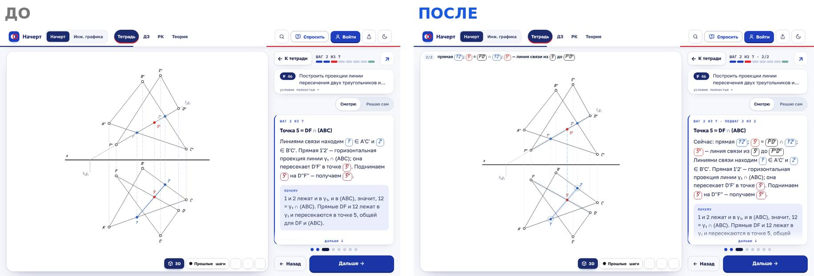

№ 46, шаг 6 «Видимость»: обводка — одним подшагом; прошлый ответ 56 приглушён, видно, что обводится сейчас.

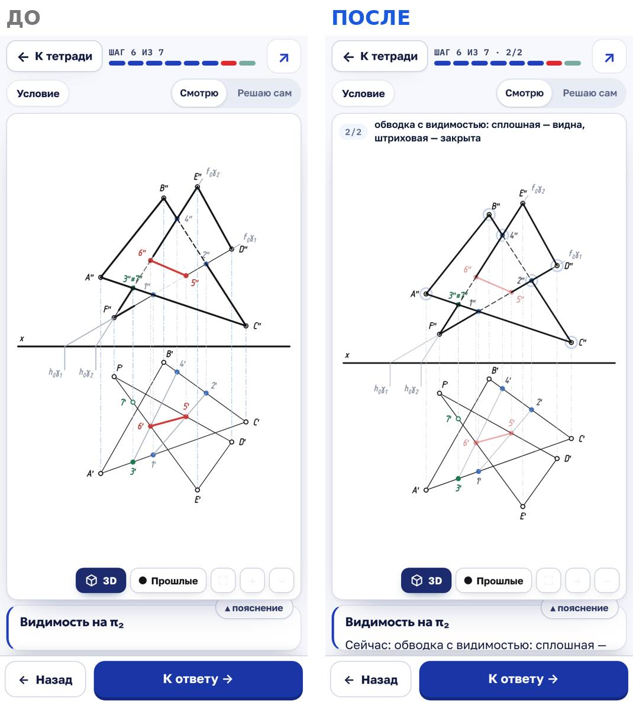

№ 45 (прямая ∩ плоскость), № 29 (h и f через K), № 38 (перпендикуляр к плоскости), № 44 (пересечение плоскостей):

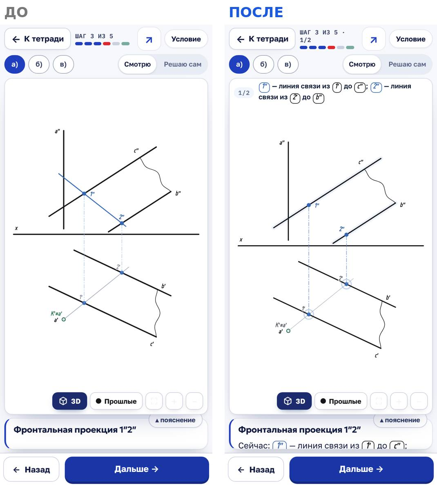
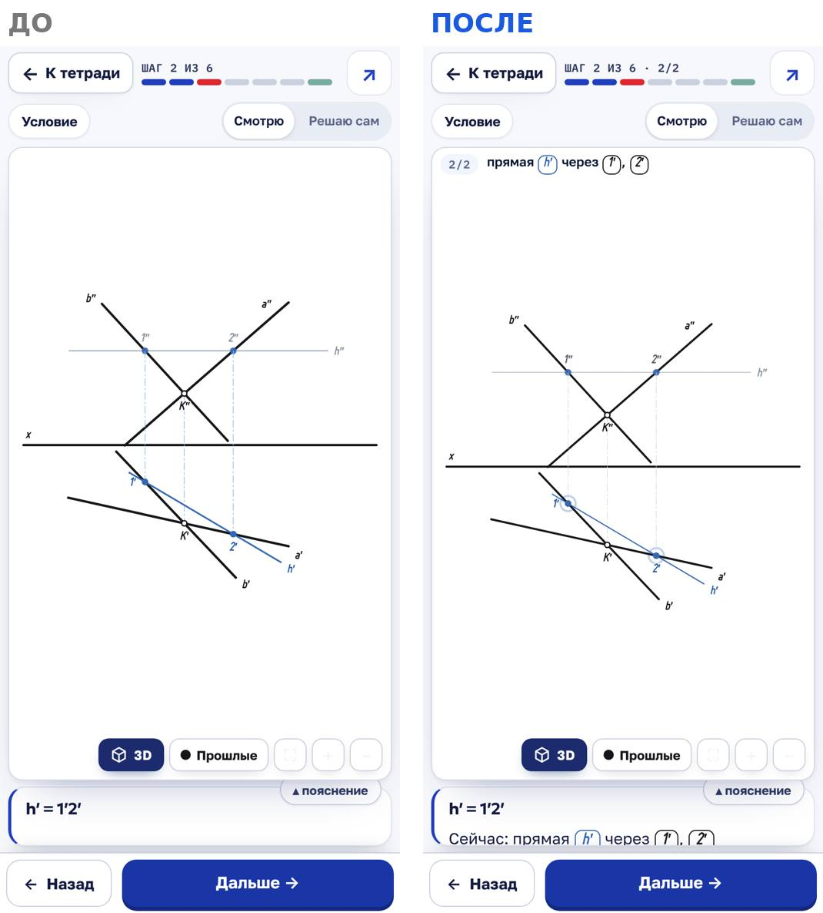
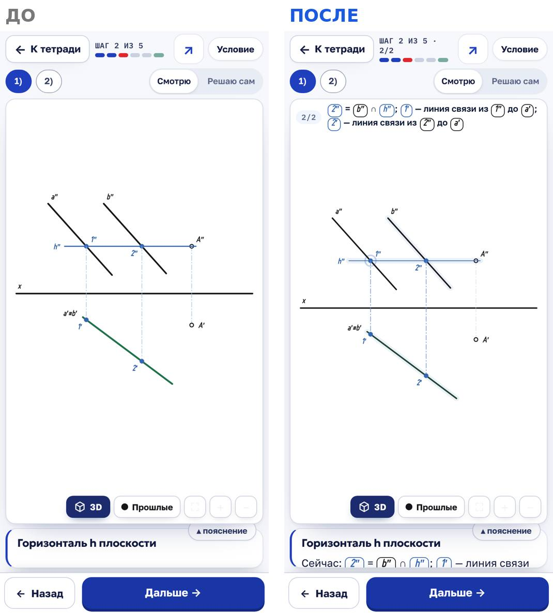
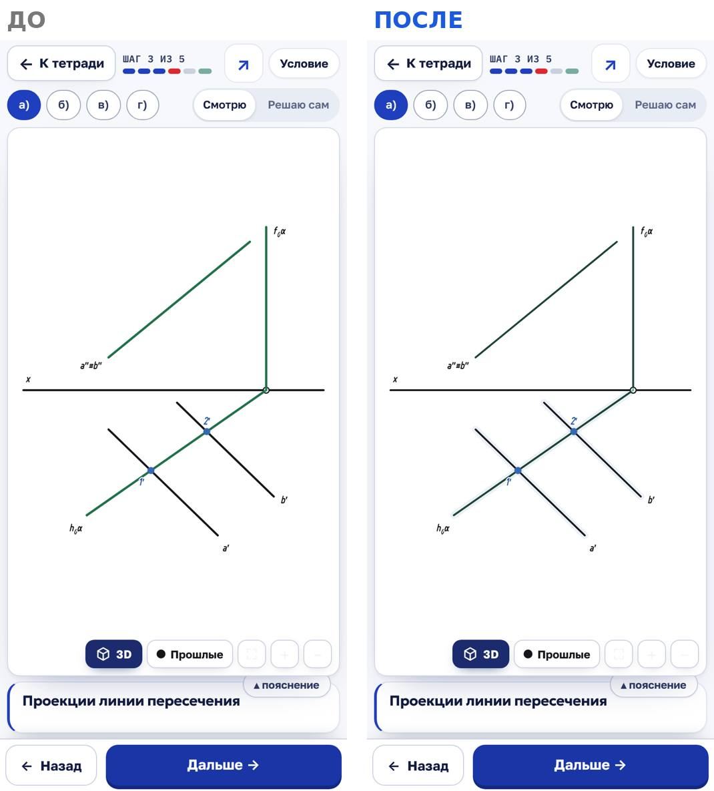

ДЗ №2, вариант 14, шаг 6 (горизонталь и фронталь основания: было 5 сущностей разом, стало 5 подшагов):

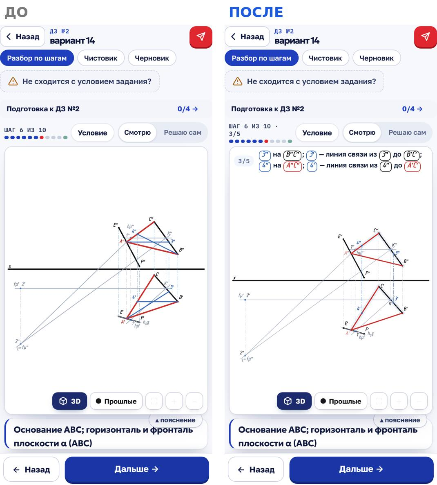
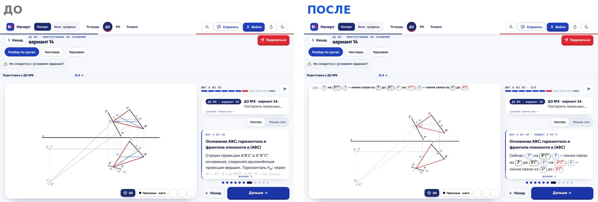

Тёмная тема (лист белый, подпись подшага читается):

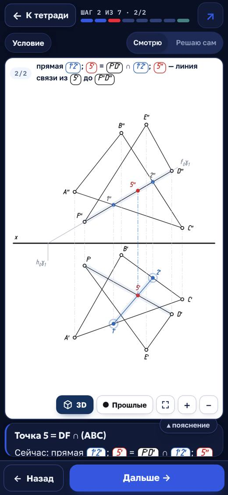

---

## Часть 2. Фундамент ИИ-тренера (без LLM)

Описание формата и правил — `docs/TUTOR.md`; карта покрытия — `docs/TUTOR-COVERAGE.md`.

| Что | Где | Состояние |
|---|---|---|
| Паспорт шага: JSON-схема | `tutor/passport.schema.json` | все 2941 паспорт проходят схему |
| Генератор из ядра | `tutor/passport.js`, `tutor/collect.js` | 89 задач тетради (745 шагов), ДЗ №1–5 по начерту — все 150 вариантов, все типы (1769 шагов), ИГ ДЗ №4 (427 шагов) |
| Автомат лестницы | `tutor/ladder.js` | переходы по попыткам, ошибкам и времени; «дальше» без попытки — повтор; ошибка из библиотеки — сначала обратная связь; Р4 — только соседний вариант; после Р2+ — самообъяснение; перед РК Р0 → Р2 → Р4 |
| Линтер и детектор секретов | `tutor/lint.js` | метки только из словаря ступени, ни одного числа, отношения — только из разрешённых фактов, секреты до Р4 запрещены, ≤ 320 символов, ≤ 1 вопрос, да/нет-выпытывание, «понятно?», похвала личности |
| Тесты | `tests/tutor.js` (блок `tutor` в `run.js`) | см. «Результаты тестов» |
| Карта покрытия | `docs/TUTOR-COVERAGE.md` | генерируется `node tests/tutor.js --coverage` |
| Тестовая страница | `tutor/index.html` (`/tutor/`, noindex, `robots.txt`) | выбор задачи → «Решаю сам» → лестница без ИИ, подсветка опор на эпюре, соседний вариант на Р4 |

Откуда берётся содержимое паспорта:
- **цель** — заголовок шага; **обоснование** — ≈ 720 «почему» тетради (97 % шагов) и «Почему так?» ДЗ (ссылки «(вопрос 14)» убраны);
- **словарь, секреты** — из чертежа ядра: известное, новое, будущее; секреты — будущее и искомое шага (цвет ответа), числа запрещены всегда;
- **факты** — из геометрии (∥ x, линия связи ⟂ x, ∈, ∩, ⟂ по знаку прямого угла) и из утверждений текста; каждый перепроверен
  по координатам; 20 373 подтверждённых факта; 132 утверждения текста ядро не подтвердило — они не разрешены и перечислены
  в карте покрытия (в основном ограничение разбора имён: «h₀γ ⟂ x», где след подписан иначе);
- **ступени** — Р0 вопрос и Р1 приём — шаблоны по 14 типам шага (Р1 — обоснование автора, если оно проходит линтер),
  Р2 — опоры шага и разрешённый факт, Р3 — подшаги `STEPVIEW` повелительно (искомое — словами), Р4 — соседний вариант;
- **ошибки** — `core/cp46.js` (точки, видимость), `core/cp47.js` (перпендикуляр, натуральная величина), ловушки подготовки
  `prep/` (по темам задачи и типу шага), GYM «найди ошибку» (разрыв линии связи, подписи местами); «как распознаётся» —
  проверка ядра или `TODO` с причиной;
- **ракурс 3D** — по типу шага (посредник — вдоль проецирующей плоскости, h — сверху, видимость — по нормали к π₁/π₂…);
- **темы** — `kernel/prep.js`: темы, закрывающие задачу или ДЗ, отобранные по типу шага.

### Покрытие (доля шагов, где поле заполнено)

| | Шагов | Цель | Почему | Факты ядра | Р0–Р3 (Р1 — автора) | Ошибки (ядро распознаёт) | Ракурс | Р4 сосед | Темы |
|---|---|---|---|---|---|---|---|---|---|
| Тетрадь | 745 | 100 % | 97 % | 93 % | 100 % (50 %) | 100 % (63 %) | 71 % | 65 % | 100 % |
| ДЗ по начерту | 1769 | 100 % | 100 % | 98 % | 100 % (23 %) | 100 % (66 %) | 81 % | 100 % | 100 % |
| ИГ (ДЗ №4) | 427 | 100 % | 100 % | 0 % | 100 % (0 %) | 0 % | 100 % | 96 % | 0 % |
| **Всего** | **2941** | 100 % | 99 % | 83 % | 100 % (26 %) | 85 % (55 %) | 81 % | 91 % | 85 % |

Главные дыры (подробно по задачам — `docs/TUTOR-COVERAGE.md`):
1. **Р4 в тетради — 65 %**: у 30 задач нет генератора вариантов (`GEN_OK`) — нет «соседнего варианта».
2. **Р1 из обоснования автора — только 26 %**: у остальных обоснование упоминает новые метки шага или числа и на Р1
   не проходит линтер — стоит шаблон по типу шага. Это первое место для ручной методики.
3. **Ошибки, которые ядро распознаёт на листе ученика**, — программы построения есть только у № 46 и № 47; у прочих
   шагов ошибки описаны (prep, GYM), но распознавание помечено `TODO`.
4. **ИГ**: шаги есть только у ДЗ №4; у ig2, ig3, ig5, ig6 решения по шагам нет — паспортов нет. Факты и ошибки ИГ — TODO
   (чертёж ИГ — не сцена `DRAW`).

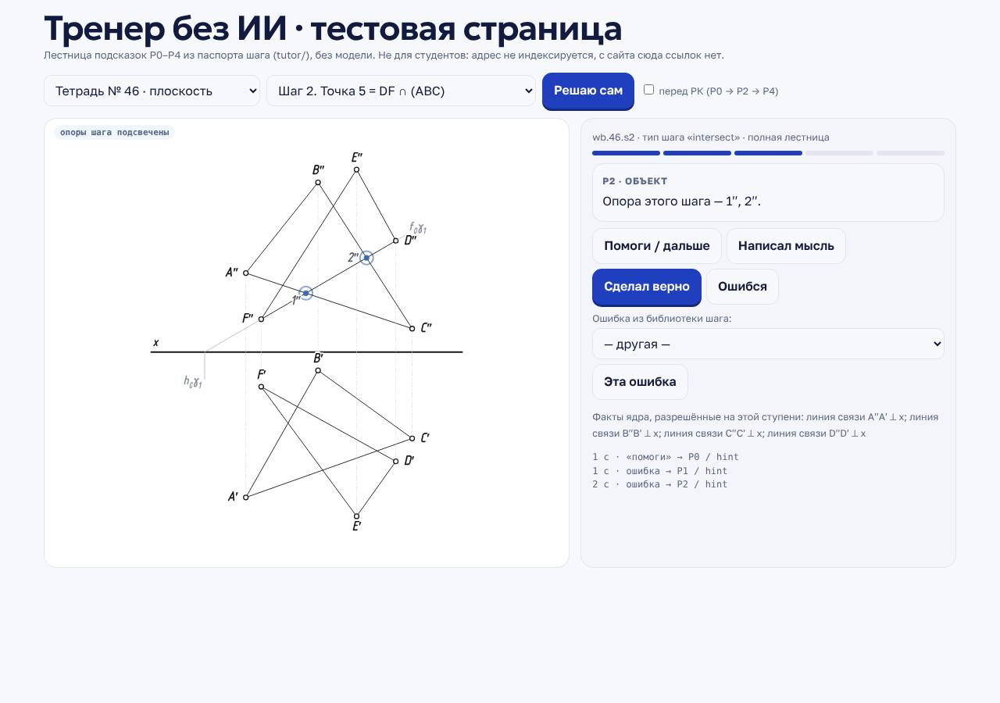
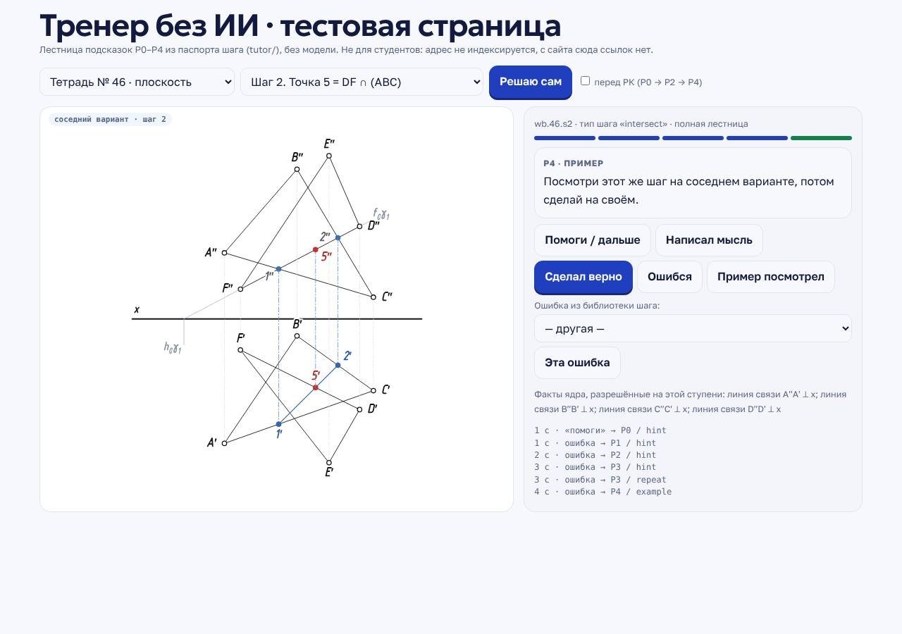

---

## Результаты тестов

РЕЗУЛЬТАТЫ_ТЕСТОВ

---

## Что осталось

1. Методика по карте покрытия: обоснования, пригодные для Р1; ракурсы для типов «построение», «фигура», «след»; Р4 для задач без генератора.
2. Распознавание ошибок на листе ученика для остальных задач (программы построения по образцу `core/cp47.js`).
3. События `action` из «Решаю сам» на сайте (сейчас их даёт тестовая страница кнопками) и проактивный пузырь у места ошибки.
4. 3D: ключевой ракурс записан в паспорт, но камера к нему ещё не ведётся (окно `TASK3D`).
5. Подшаги — пока только задачи на плоскость; для поверхностей (кривые по точкам) нужно своё правило группировки.
6. 40 линий в задачах на плоскость без имени (линии связи в новых системах плоскостей) — подписаны в подшаге как «вспомогательная линия».

## Решения, принятые самостоятельно

1. **Подшаги — по нажатию «Дальше»**, а не автопроигрыш по времени: так у каждого подшага своя подпись и можно вернуться.
   Вперёд на один шаг — с первого подшага; назад и по точкам — шаг целиком.
2. **Сущность = точка или линия, обе проекции — одна сущность**; на подшаг — до двух. Порядок — как у автора в `add`.
3. **Искомое — той же толщины, что основная линия**, отличается цветом; прошлое искомое приглушено (не серое — «красный — только искомое»).
4. **Цвет подсветки опор — синий карандаш `#3567b5`** (токен чертежа), жёлтый маркер не вернул (убран 14 ноября).
5. **Подшаги и опоры — только задачи на плоскость** (по просьбе — список); толщины и приглушение — на всех чертежах `DRAW`, чтобы язык чертежа был один.
6. **Обход в `tests/run.js`**: лимит нажатий «Дальше» 40 → 200 (подшагов стало больше); тест, проверявший старые толщины, не нашёлся.
7. **Паспорт строится в браузере** (там задачи `WB3`, решатели ДЗ, генератор `GEN`); автомат, линтер и схема — чистые модули, тестируются и в Node.
8. **Секрет = будущие метки + искомое шага (цвет ответа) + все числа**; сущность секретна, если секретны все её проекции.
   Новые точки шага называются только с Р3, новые линии — с Р2.
9. **Факт в паспорте — только подтверждённый ядром**; утверждения текста, которые ядро не подтвердило, остаются с `verified:false` и в разрешённые не попадают.
10. **Соседний вариант**: тетрадь — генератор `GEN` (сид 101, при неудаче 202, 303), только если число шагов совпало; ДЗ — ближайший решаемый вариант того же типа.
11. **Тестовая страница не трогает сайт**: грузит `index.html` в скрытый `iframe` и берёт оттуда ядро; адрес `/tutor/`, `noindex` и `Disallow` в `robots.txt`.
12. **ИГ — в урезанном виде** (по порядку сокращений: тестовая страница → ИГ → ракурсы): паспорта только для ДЗ №4, факты и ошибки — TODO.
